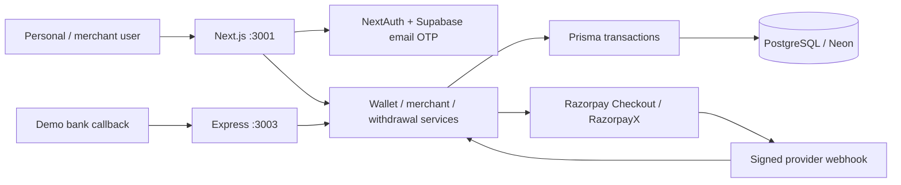

# EasePay

A full-stack wallet and merchant payments application . Personal wallets, merchant QR checkout, bank withdrawals, and phone authentication share a responsive web application.

**Stack:** Next.js 16 · React 19 · TypeScript · Tailwind CSS · NextAuth · Prisma 5 · PostgreSQL/Neon · Express · pnpm/Turborepo · Docker · GitHub Actions.

## Architecture



See [the detailed architecture and payment sequence](docs/ARCHITECTURE.md). This reflects the implemented code and the course concepts; provider integrations need configured credentials.

## Docker quick start

Requires Docker Desktop (running) and Node.js 22 for the configuration helper. Stop any existing app on ports 3001/3003 first.

```sh
node scripts/setup-docker.mjs
docker compose --env-file .env.docker up --build -d
docker compose --env-file .env.docker ps
```

Open **http://localhost:3001**. The stack starts PostgreSQL, waits for database health, applies migrations once, then starts the web app and webhook service. PostgreSQL data persists in a named volume and is not published to the host. App ports bind to localhost. Secrets are generated into the ignored `.env.docker`; rerunning the helper preserves existing keys.

```sh
# Inspect logs and stop while preserving database data
docker compose --env-file .env.docker logs -f web webhook
docker compose --env-file .env.docker down
```

Configure Supabase email OTP in `.env.docker` for signup and code login; see [AUTH.md](AUTH.md). Existing accounts can also use password login. No accounts are seeded automatically. This Compose stack uses simulated payments.

To use Neon, set `DATABASE_URL` in `.env.docker` to your Neon connection string, including its required TLS parameters. The migration job and both apps use that URL. The local database service still starts but is unused. Back up the selected database before deploying schema changes.

## CI/CD

[GitHub Actions](.github/workflows/ci.yml) runs frozen dependency installation, Prisma generation, lint, tests, type checks, and production build on pull requests and pushes to `main`. It also builds the containers against a fresh PostgreSQL database, applies migrations, waits for health checks, and smoke-tests login, signup, and webhook health.

After successful checks, pushes to `main` and `v*` tags publish three images to GHCR: `ghcr.io/ravichandra531/easepay-web`, `easepay-webhook`, and `easepay-migrate`. Each image has an immutable commit tag and a `latest` or release tag. Publishing uses the repository's built-in `GITHUB_TOKEN` with package write permission; no registry password needs to be committed.

This implements continuous integration and container delivery. Automatic deployment to a live host is not configured because no hosting target or deployment credentials have been supplied. On a host, inject runtime secrets, run the migration image before app rollout, use HTTPS with the correct `APP_URL`/`NEXTAUTH_URL`, and preserve the database and encryption key. See [BANKING.md](BANKING.md) before enabling provider-backed payments.

## Wallet and business flows

- A blue and white landing page inspired by Venmo, with local Lucide icons and working feature links.
- Merchant signup/onboarding, public payment links, downloadable QR codes, customer receipts, and payment notifications.
- Camera/image QR scanning where supported, with a payment-link fallback.
- Encrypted bank accounts, withdrawal confirmation, reserved funds, persistent payout history, and failure/reversal refunds.
- Razorpay Checkout orders, payment verification, RazorpayX IMPS payouts, and signed webhooks. Live/test banking needs configured credentials.

## Existing wallet flows

- Matching login/signup pages, phone OTP login and verified signup, plus email/phone password login. See [AUTH.md](AUTH.md) for SMS setup and local development codes.
- Dashboard with available and locked balances, sent/received totals, and recent activity.
- Add money through HDFC, Axis, SBI, or ICICI. New payments are pending until confirmed.
- A local bank sandbox to approve or cancel demo payments. It requires sign-in and only permits settling your own payment. No real bank credentials or money are involved.
- Resume pending payments from Activity. Replayed callbacks do not credit funds twice.
- Search registered recipients by name or phone, review a payment, then confirm.
- Atomic transfers, a persistent ledger shared by both parties, and idempotent retries.
- Activity search, status/type filters, 20-item pages, expandable payment details, and CSV export of filtered results.
- Account editing with current-password confirmation and updated session details.
- Responsive desktop sidebar/mobile navigation, loading and error screens, and reduced-motion support.
- Automatic refresh every 15 seconds and when returning to the window.

## Run locally

Requires Node.js 22+, pnpm 9, and an accessible PostgreSQL database.

```sh
pnpm install
cp packages/db/.env.example packages/db/.env
cp apps/user-app/.env.example apps/user-app/.env
cp apps/bank-webhook/.env.example apps/bank-webhook/.env
```

If `.env` files already exist, update them instead of overwriting them. Put the same database URL in all three files. Generate separate random `NEXTAUTH_SECRET` and `WEBHOOK_SECRET` values. The user app also supports the previous `JWT_SECRET` variable.

```sh
pnpm db:generate
pnpm db:migrate
# Optional: create sample accounts and demo funds in a development database
pnpm db:seed
pnpm dev
```

User app: **http://localhost:3001**

Webhook: **http://localhost:3003/health**

The migration adds a unique transfer request key and history indexes. It retains existing users, balances, deposits, and transfers. Existing transfers from before the ledger was implemented cannot be reconstructed automatically.

Sample accounts created by the optional seed use phone numbers `9999999001`, `9999999002`, and `9999999003`, with password `password123`. Newly registered accounts start at zero.

## Try the full demo

1. Sign in or register, then choose **Add money**.
2. Choose a bank and amount, then continue to the payment screen.
3. Click **Approve demo payment** or **Cancel payment**. View the resulting balance and activity.
4. Open **Send money**, search a second registered user, and review the amount and recipient.
5. Confirm, then inspect Activity in the sender and recipient accounts.
6. Filter, search, expand a payment, or export the visible filtered history to CSV.

`BANK_SANDBOX_ENABLED=true` explicitly enables demo approvals, including during a production build run locally. Turn it off when connecting a real payment provider. Merchant accounts, QR checkout, bank accounts, and withdrawals are implemented. Razorpay Checkout and RazorpayX adapters require credentials and provider approval. Automated merchant settlement is not included. See `BANKING.md` for mode separation, provider configuration, and verification limits.

## Verified bank callbacks

`POST /hdfcWebhook` and `POST /bankWebhook` require the `x-webhook-secret` header. An unset secret returns 503; an incorrect secret returns 401.

```json
{
  "token": "payment-token-from-the-pending-deposit",
  "status": "Success"
}
```

`status` accepts `Success` or `Failure` and defaults to `Success`. The server always uses the stored transaction's owner and amount. Optional `user_identifier` and `amount` fields, when provided, must match that record. Successful replays return 200 without crediting again; conflicting outcomes return 409.

## Checks

```sh
pnpm test
pnpm lint
pnpm check-types
pnpm build
```

Regression tests cover decimal parsing, input boundaries, internal sign-in redirects, transfer ledger writes, insufficient funds, duplicate request protection, callback amount/owner matching, cancellation, and replay handling. Service tests mock the database boundary; they do not replace live database concurrency testing.

## Course references

- https://projects.100xdevs.com/tracks/Paytm/paytm17-1
- https://projects.100xdevs.com/tracks/PayTM2/paytm2-1

Some chapters require a logged-in course account. The implementation follows the accessible on-ramp material and completes the existing user-wallet app. Real bank settlement requires a provider integration and verified production callbacks.

## Banking setup

Read [BANKING.md](BANKING.md) before configuring provider credentials. Live operations have not been tested in this workspace.

## Deploy the web app on Vercel

Import this repository with **Root Directory `apps/user-app`**, **Framework Next.js**, and **Node.js 22.x**. Enable **Include source files outside of the Root Directory in the Build Step** so the app can access shared workspace packages. The app's `vercel.json` installs pnpm 9.0.0 dependencies from the repository root, generates Prisma, builds only the user app, and selects `.next` as output. Clear old dashboard overrides for install/build commands and output directory so this file controls them. Next.js is declared in `apps/user-app/package.json`; using the repository root as the Vercel Root Directory causes `NEXT_NO_VERSION`. Deploy the Next.js app directly; the Docker Compose stack is for a container host.

Set `DATABASE_URL` to the Neon TLS connection string and configure `NEXTAUTH_SECRET`, `NEXTAUTH_URL`, `APP_URL`, and `BANK_ACCOUNT_ENCRYPTION_KEY` as private Vercel environment variables. Both URL variables must use your deployed HTTPS domain. Set `NEXT_PUBLIC_SUPABASE_URL` and `NEXT_PUBLIC_SUPABASE_PUBLISHABLE_KEY` for email OTP, then configure Supabase email templates and custom SMTP; see [AUTH.md](AUTH.md). Configure payment mode and provider keys using [BANKING.md](BANKING.md). Apply database migrations separately with `pnpm db:migrate` before rollout; the build does not modify your database.

The Express demo bank webhook is a separate service and is not deployed by this Vercel configuration. Razorpay's signed webhook lives inside Next.js at `/api/webhooks/razorpay`. After changing deployment settings, redeploy without the previous build cache.
