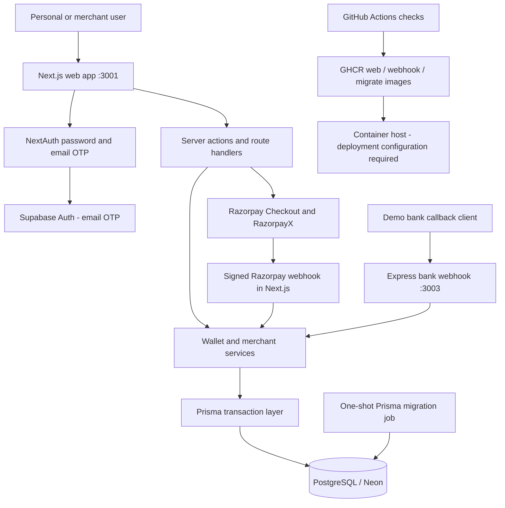
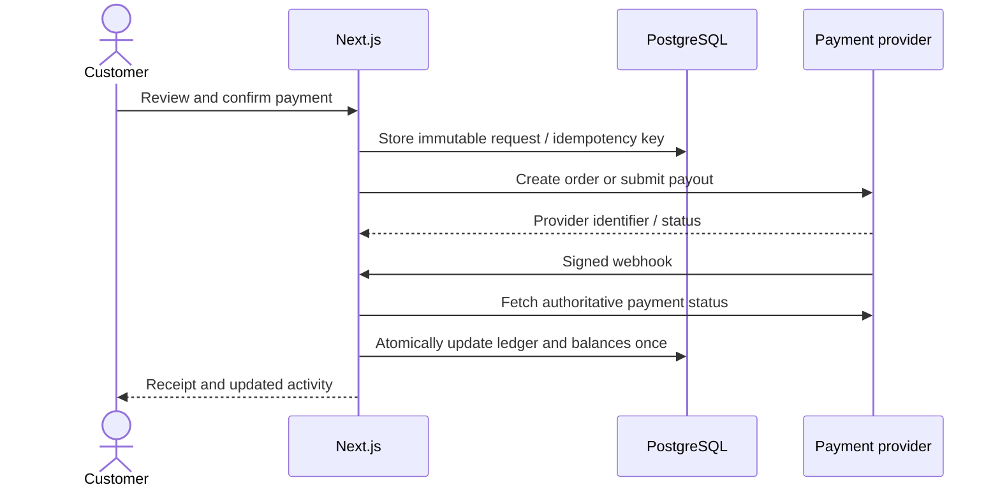

# EasePay architecture

This diagram documents the implemented app, informed by the two 100xDevs Paytm project references. It is an original diagram of this repository, rather than a reproduction of an inaccessible course image.

## Payment lifecycle

P2P and merchant wallet transfers run in database transactions. Idempotency keys prevent repeated requests from moving funds twice. Withdrawals reserve funds before contacting the payout provider; confirmed failures and reversals restore them once. Uncertain outcomes retain the reservation pending reconciliation. Demo and real funds are tracked separately.

Bank account details are encrypted with AES-256-GCM. Supabase verifies single-use email codes and enforces authentication rate limits. Wallet accounts are created only after email verification succeeds. The Express demo webhook requires a shared secret; provider webhooks verify a signature and fetch provider status before updating funds.

There is one Next.js application for personal and merchant experiences, not separate deployed merchant/admin apps. There is no Redis, queue worker, automatic settlement scheduler, or Kubernetes cluster in this implementation.

## References

- [100xDevs Paytm project](https://projects.100xdevs.com/tracks/Paytm/paytm17-1)
- [100xDevs Paytm Part 2](https://projects.100xdevs.com/tracks/PayTM2/paytm2-1)

The course pages require access for some content; exact reference diagrams were not available as readable content. The repository and its code determine the architecture above.
